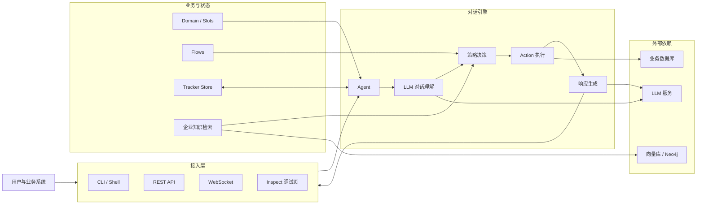
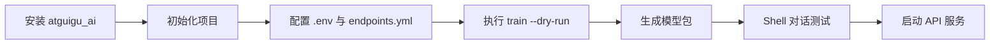
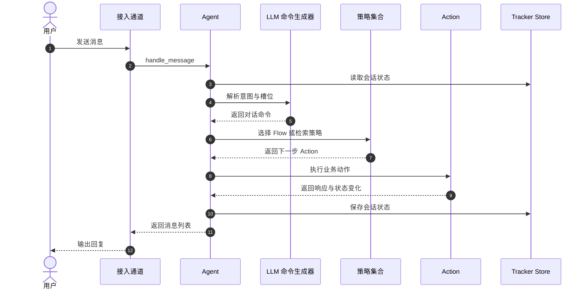
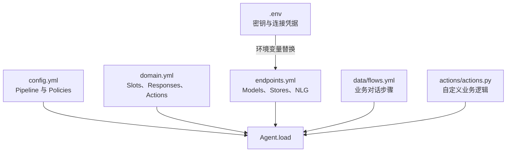

# `atguigu_ai`

`atguigu_ai` 是一个面向学习和业务原型开发的 LLM 智能对话框架。项目提供 Flow 对话流程、槽位管理、自定义 Action、企业知识检索、会话状态存储，以及基于 FastAPI 的 REST API 和调试页面。

当前版本：`0.1.0`

## 核心能力

- 使用 LLM 理解用户输入并生成对话命令
- 使用 Flow 描述多轮对话流程
- 通过 Domain 管理槽位、响应模板和自定义动作
- 支持 OpenAI、通义千问、Azure OpenAI、Anthropic 等模型配置
- 支持自定义企业知识检索器和向量存储
- 支持内存、JSON、MySQL 会话状态存储
- 提供命令行对话、REST API、WebSocket 和 Inspect 调试页面
- 支持训练、打包和导出可部署模型

## 系统架构



框架将接入通道、对话编排和外部基础设施分开：业务流程主要维护在 Domain、Flow 与 Action 中，模型和存储连接集中配置在 `endpoints.yml`。

## 环境要求

- Python `3.10`、`3.11` 或 `3.12`
- pip
- 可用的 LLM API Key

本地嵌入模型、MySQL、Neo4j 等组件只在使用对应能力或运行电商示例时需要。

## 快速开始



### 1. 安装项目

在仓库根目录创建虚拟环境并以开发模式安装：

```powershell
python -m venv .venv
.\.venv\Scripts\Activate.ps1
python -m pip install --upgrade pip
pip install -e .
```

安装完成后，以下命令应能输出版本信息：

```powershell
atguigu --version
```

### 2. 初始化对话项目

```powershell
atguigu init --path .\my_assistant --no-prompt
Set-Location .\my_assistant
```

生成的项目结构如下：

```text
my_assistant/
|-- config.yml          # Pipeline 和策略配置
|-- domain.yml          # 槽位、响应和动作定义
|-- endpoints.yml       # LLM、嵌入、存储等端点配置
|-- data/
|   `-- flows.yml       # 对话流程
|-- actions/
|   |-- __init__.py
|   `-- actions.py      # 自定义 Action
|-- models/             # 训练产物
`-- tests/
```

### 3. 配置模型密钥

CLI 会自动加载当前对话项目目录下的 `.env` 文件。默认模板使用通义千问，可创建：

```dotenv
DASHSCOPE_API_KEY=your-api-key
```

`endpoints.yml` 中的模型配置通过 `${DASHSCOPE_API_KEY}` 引用该变量：

```yaml
models:
  default:
    type: qwen
    model: qwen-plus
    api_key: ${DASHSCOPE_API_KEY}
    temperature: 0.0
```

不要将 `.env` 或真实 API Key 提交到版本库。

### 4. 校验并训练

先校验 Domain、Flow 和配置文件：

```powershell
atguigu train --dry-run
```

校验通过后生成模型包：

```powershell
atguigu train
```

训练产物默认写入 `models/`，格式为 `.tar.gz`。

### 5. 测试对话

直接加载当前项目进行命令行对话：

```powershell
atguigu shell --model .
```

Shell 内置命令：

| 命令 | 说明 |
| --- | --- |
| `/help` | 查看帮助 |
| `/reset` | 重置当前会话 |
| `/slots` | 查看槽位值 |
| `/history` | 查看对话历史 |
| `/debug` | 切换调试日志 |
| `/quit` | 退出 Shell |

### 6. 启动 API 服务

```powershell
atguigu run --model . --host 0.0.0.0 --port 5005
```

启动后可访问：

- API 文档：<http://localhost:5005/docs>
- ReDoc：<http://localhost:5005/redoc>
- Inspect 页面：<http://localhost:5005/inspect>
- 健康检查：<http://localhost:5005/health>

使用 PowerShell 发送一条消息：

```powershell
$body = @{
    sender = "demo-user"
    message = "你好"
} | ConvertTo-Json

Invoke-RestMethod `
    -Method Post `
    -Uri "http://localhost:5005/api/messages" `
    -ContentType "application/json" `
    -Body $body
```

## 常用 CLI

| 命令 | 用途 | 示例 |
| --- | --- | --- |
| `atguigu init` | 初始化对话项目 | `atguigu init --path ./my_bot` |
| `atguigu train` | 校验配置并生成模型包 | `atguigu train --dry-run` |
| `atguigu shell` | 启动命令行交互测试 | `atguigu shell --model .` |
| `atguigu run` | 启动对话 API 服务 | `atguigu run --model . --port 5005` |
| `atguigu inspect` | 启动可视化调试页面 | `atguigu inspect --model .` |
| `atguigu export` | 导出模型、配置或数据 | `atguigu export --output ./export/model.tar.gz` |

查看完整参数：

```powershell
atguigu --help
atguigu <command> --help
```

## 主要 API

默认监听地址为 `0.0.0.0:5005`。

| 方法 | 路径 | 说明 |
| --- | --- | --- |
| `GET` | `/health` | 检查服务和 Agent 状态 |
| `POST` | `/api/messages` | 发送用户消息 |
| `GET` | `/api/sessions/{session_id}` | 查询会话状态 |
| `POST` | `/api/sessions/{session_id}/reset` | 重置会话 |
| `GET` | `/api/domain` | 查询 Domain 信息 |
| `GET` | `/api/flows` | 查询 Flow 信息 |
| `GET` | `/api/tracker/{session_id}/full` | 查询完整 Tracker 状态 |
| `WS` | `/api/stream` | WebSocket 消息通道 |

`POST /api/messages` 请求示例：

```json
{
  "sender": "demo-user",
  "message": "查询我的订单",
  "metadata": {
    "source": "readme"
  }
}
```

### 消息处理链路



## 配置文件



### `config.yml`

定义对话理解 Pipeline 和策略。默认使用 `LLMCommandGenerator`、`FlowPolicy` 和 `EnterpriseSearchPolicy`。

### `domain.yml`

定义对话系统的业务语义，包括：

- `slots`：会话槽位及其映射方式
- `responses`：响应模板
- `actions`：自定义动作名称
- `forms`：表单定义

### `endpoints.yml`

定义运行时依赖，包括：

- `models`：LLM 模型
- `embeddings`：嵌入模型
- `vector_store`：向量存储连接参数
- `tracker_store`：会话状态存储
- `nlg`：响应生成与重述配置

配置值支持 `${VAR_NAME}` 和 `${VAR_NAME:default}` 环境变量占位符。

### `data/flows.yml`

定义对话 Flow。每个 Flow 由描述、步骤、动作和后续节点组成，用于组织可控的多轮业务流程。

### `actions/actions.py`

自定义 Action 继承 `atguigu_ai.agent.actions.Action`，实现异步 `run` 方法并返回 `ActionResult`。项目加载时会自动发现并注册 Action。

## 源码结构

```text
atguigu_ai/
|-- agent/                    # Agent、消息处理和 LangGraph 执行图
|-- api/                      # FastAPI 服务
|-- channels/                 # REST、Socket.IO、控制台等输入通道
|-- cli/                      # 命令行入口
|-- core/                     # Domain、Slot、Tracker 和存储
|-- dialogue_understanding/   # 命令生成、解析和 Flow 执行
|-- nlg/                      # 响应生成与重述
|-- policies/                 # Flow 和企业搜索策略
|-- retrieval/                # Flow 与向量检索
|-- shared/                   # 配置、常量、异常和 LLM 客户端
`-- training/                 # 训练与模型打包

ecs_demo/                     # 电商客服示例
setup.py                      # Python 包和 CLI 安装配置
requirements-atguigu.txt      # 运行依赖
```

## 电商客服示例

`ecs_demo/` 展示订单、物流和售后场景，包含业务 Domain、Flows、自定义 Action 和 GraphRAG 检索实现。

运行该示例前，需要根据 `ecs_demo/endpoints.yml` 准备：

- 通义千问 API Key：`DASHSCOPE_API_KEY`
- Neo4j：默认地址 `bolt://localhost:7687`
- MySQL：用于电商业务数据
- 对应环境变量：`NEO4J_PASSWORD`、`MYSQL_PASSWORD`

配置完成后，在示例目录执行：

```powershell
Set-Location .\ecs_demo
atguigu train --dry-run
atguigu shell --model .
```

示例中的数据库连接、表结构和数据生成脚本需要按本地环境调整后再使用。

## 开发

安装开发依赖：

```powershell
pip install -e ".[dev]"
```

验证包是否安装成功：

```powershell
python -c "import atguigu_ai; print(atguigu_ai.__version__)"
atguigu --help
```

## 常见问题

### PowerShell 不允许激活虚拟环境

可仅为当前进程放开执行策略：

```powershell
Set-ExecutionPolicy -Scope Process -ExecutionPolicy Bypass
.\.venv\Scripts\Activate.ps1
```

### 提示找不到 `atguigu` 命令

确认当前虚拟环境已激活，并在仓库根目录重新执行：

```powershell
pip install -e .
```

也可以通过模块入口运行：

```powershell
python -m atguigu_ai --help
```

### 模型鉴权失败

检查当前对话项目目录下的 `.env`、`endpoints.yml` 中的变量名，以及 API Key 是否有效。CLI 以当前工作目录作为配置和 `.env` 的查找起点。

### 启动后无法访问服务

默认端口为 `5005`。本机浏览器应使用 `http://localhost:5005`，而不是监听地址 `http://0.0.0.0:5005`。

## License

MIT
