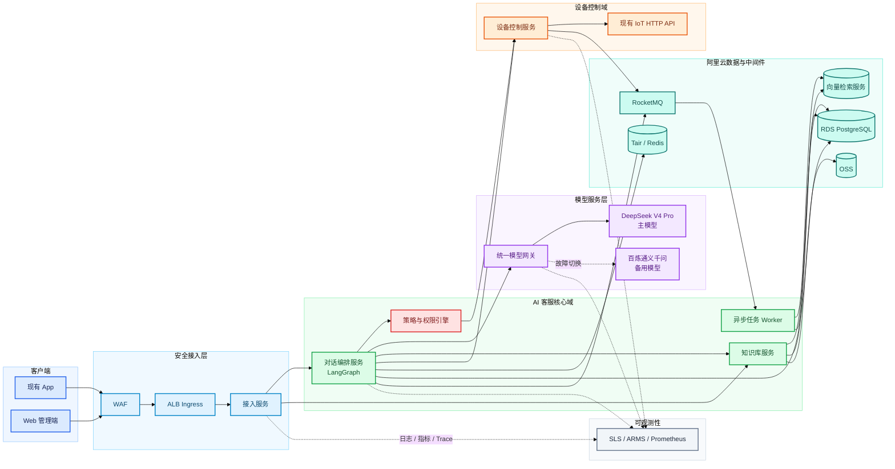
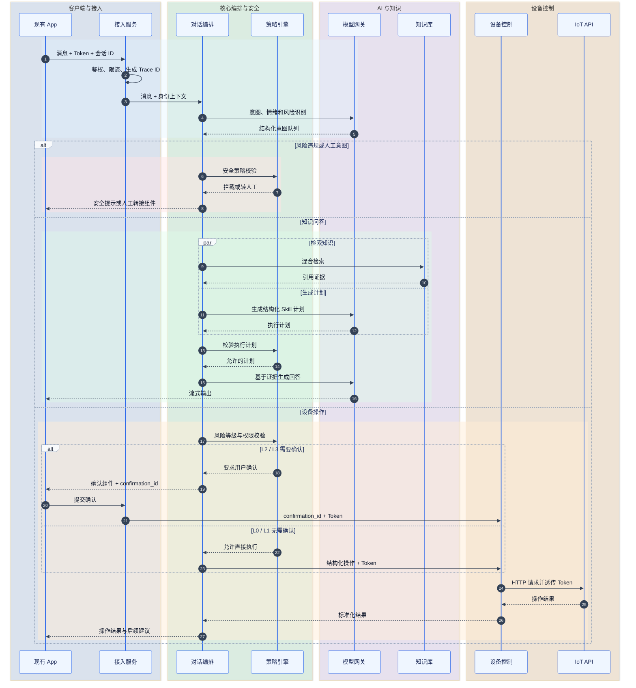
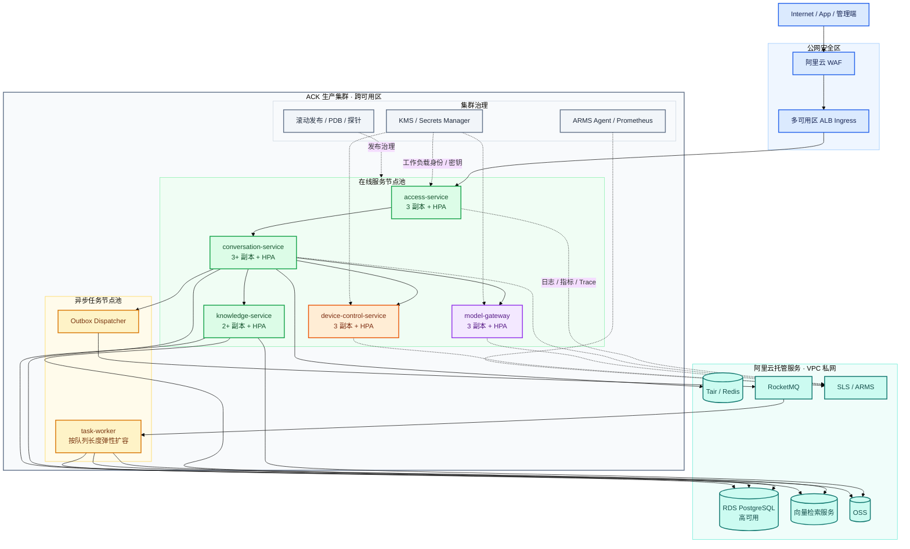

# AI 客服生产版技术架构设计

> 状态：已确认  
> 日期：2026-07-23  
> 部署平台：阿里云 ACK Kubernetes  
> 参考资料：飞书 Wiki《CAM180 V2.0.0》中的智能客服、知识库、意图处理、主 Agent 与 Skill 定义

## 1. 背景与目标

当前项目是基于 Python、FastAPI 与 LangGraph 的 AI 客服框架，已有 `Domain + Flow + Slots + Tracker + Action`、Command/DSL、RAG、WebSocket 和人工转接内核。本设计在保持现有领域结构的基础上，将系统扩展为可上线的生产版本。

一期建设范围：

- 现有 App 智能客服入口与流式对话。
- Web 管理端，包括知识库、Prompt、Skill、模型、会话和审计管理。
- DeepSeek V4 Pro 与阿里云百炼通义千问的多模型容灾。
- 问答对、Markdown 长文档和结构化业务知识的检索增强生成。
- 通过现有 IoT HTTP API 执行完整设备控制。
- 按风险等级执行设备写操作确认、权限校验、幂等控制和审计。
- 人工客服仅预留统一适配接口，一期不建设坐席系统。

暂定容量基线：

| 指标 | 基线 |
|---|---:|
| 日会话量 | 10,000 |
| 峰值并发 | 100 |
| 平均会话轮数 | 10 |
| 对话接口可用性 | 99.9% |
| 首字响应 P95 | 不高于 2 秒 |

## 2. 架构决策

采用控制规模的领域服务化架构。同步主链路使用 HTTP/WebSocket，异步任务和领域事件使用 RocketMQ。只拆分需要独立扩容、故障隔离或安全隔离的服务，不采用全事件驱动微服务。

主要原因：

- AI 模型、知识检索和设备控制具有不同的扩容与故障特征。
- 设备控制需要独立的权限、安全、幂等和审计边界。
- 多模型容灾与知识索引需要独立治理和灰度能力。
- 当前规模不需要为每个 Skill 建立独立微服务。

## 3. 总体架构



## 4. 服务边界

### 4.1 接入服务

- 提供 App HTTP API、WebSocket/SSE 和 Web 管理端 API。
- 校验登录态、请求签名、App 版本和基础访问权限。
- 建立 `trace_id`、`conversation_id` 和用户身份上下文。
- 执行网络、用户、会话和模型成本限流。
- 用户 Token 仅在当前请求内存中传递，不写入持久化设施。

一期 Web 管理端后端并入接入服务，不额外拆分管理微服务。

### 4.2 对话编排服务

- 使用 LangGraph 管理会话状态、意图队列和 Skill 编排。
- 执行意图、情绪、风险、人工转接和超范围识别。
- 主 Agent 只生成结构化执行计划，不直接调用 IoT API。
- 负责多意图去重、因果合并、关键实体追问和上下文切换。
- 聚合知识检索、业务 Skill 和设备操作结果，流式输出最终回答。

### 4.3 模型网关

- 对上提供与具体模型供应商无关的统一调用协议。
- 负责模型路由、超时、重试、限流、熔断和自动切换。
- 记录模型、版本、Prompt 版本、延迟、Token 用量和估算成本。
- 不记录原始用户 Token、密钥或未经脱敏的敏感信息。

### 4.4 知识库服务

- 管理问答对、Markdown 文档、结构化知识、分类、版本和发布状态。
- 负责查询改写、混合召回、权限过滤、重排与引用证据返回。
- 通过 `VectorStorePort` 隔离阿里云向量检索 SDK。
- RDS 保存事实状态，OSS 保存原始文件，向量服务只承担检索。

### 4.5 设备控制服务

- 通过 `DeviceControlAdapter` 接入现有 IoT HTTP API。
- 统一处理用户 Token 透传、超时、错误码映射和结果查询。
- 管理能力注册表、风险分级、确认凭证、幂等、防重和操作审计。
- LLM 只能提出结构化操作建议，无权决定最终权限和风险等级。

### 4.6 异步任务 Worker

- 执行文档解析、切片、Embedding、索引构建和清理。
- 执行追问生成、审计归档、Outbox 投递和失败补偿。
- 按任务队列长度独立水平扩容。

### 4.7 人工转接适配层

定义 `HumanHandoffPort`，转接数据包含会话摘要、用户、设备、意图、情绪和最近对话。一期仅支持创建工单或展示人工联系方式，后续可接入实际客服系统。

## 5. 核心对话链路



关键规则：

- 模型输出必须通过 JSON Schema、字段白名单和策略校验。
- RAG 证据不足时进行追问、保守拒答或提示人工服务。
- 停止生成只终止模型输出，不回滚已成功执行的设备操作。
- App 断线不取消已确认并提交的操作，可通过 `operation_id` 查询。
- App 重连时携带最后事件序号，服务端补发缺失的流式事件。

## 6. 多模型容灾

| 任务 | 主模型 | 备用模型 | 超时建议 |
|---|---|---|---:|
| 意图与情绪识别 | 百炼轻量模型 | DeepSeek | 2 秒 |
| 主 Agent 规划 | DeepSeek V4 Pro | 通义千问 | 8 秒 |
| 最终回答生成 | DeepSeek V4 Pro | 通义千问 | 首字 2 秒，总计 30 秒 |
| 相关追问生成 | 百炼轻量模型 | 跳过该功能 | 5 秒 |
| Embedding | 百炼 Embedding | 兼容的备用版本 | 5 秒 |

容灾约束：

1. 仅连接失败、限流、服务端错误和超时触发自动切换。
2. 参数错误、内容安全拒绝和业务校验失败不得换模型绕过。
3. 首个有效 Token 输出前允许切换；输出后中断不得拼接另一模型续文。
4. 输出中断时保留已生成内容并返回 `generation_interrupted`。
5. Redis 记录供应商健康状态，熔断器使用关闭、打开和半开状态。
6. 会话内记录模型切换原因，确保问题可追踪和成本可核算。

## 7. 知识库与 RAG

知识类型包括：

- 问答对：标准问题、同义问法和标准答案。
- Markdown 长文档：说明书、操作指引和故障排查流程。
- 结构化知识：设备能力、错误码、页面导航和服务政策。

动态设备状态不得进入知识库，必须调用设备查询 API 获取。

检索流程：

1. 改写查询并保留设备型号、错误码、固件版本等实体。
2. 关键词与向量混合召回，初始召回建议为 20 条。
3. 按租户、产品、型号、地区、语言和发布状态强制过滤。
4. Rerank 选择 3 至 5 条证据。
5. 低于置信阈值时拒答或追问。
6. 回答记录 `document_version_id` 和切片 ID。

知识发布状态：

```text
DRAFT -> REVIEWING -> PUBLISHED -> DISABLED -> ARCHIVED
```

新版本索引成功后再原子切换；索引失败时旧版本继续服务。删除先逻辑下线，再异步清理向量和 OSS 文件。

## 8. 设备控制安全设计

### 8.1 固定执行链路

```text
LLM 操作提议
  -> Schema 校验
  -> 能力注册表匹配
  -> 风险等级判定
  -> 用户与设备权限校验
  -> 必要的用户确认
  -> 幂等与防重
  -> IoT HTTP 调用
  -> 结果确认
  -> 审计落库
```

### 8.2 风险等级

| 等级 | 示例 | 策略 |
|---|---|---|
| L0 查询 | 状态、版本、套餐查询 | 无需确认 |
| L1 低风险写 | 云台转动、夜视开关 | 可直接执行并返回结果 |
| L2 中风险 | 隐私模式、通知设置、共享权限 | 一次确认 |
| L3 高风险或不可逆 | 解绑、删除录像、格式化、恢复出厂 | 二次确认、短期凭证、完整审计 |
| L4 禁止执行 | 所有权转移、支付退款 | 只提供指引或人工转接 |

风险等级由服务端能力注册表和策略引擎决定，LLM 与管理端普通用户无权降低等级。

### 8.3 确认凭证

`confirmation_id` 为服务端签发的短期单次凭证，至少绑定：

```json
{
  "user_id": "u_123",
  "device_id": "cam_889",
  "action": "factory_reset",
  "params_digest": "sha256:...",
  "risk_level": "L3",
  "expires_at": "2026-07-23T15:05:00+08:00",
  "nonce": "single-use-random-value"
}
```

- 默认有效期 2 分钟，只能消费一次。
- 用户、设备、动作或参数变化后立即失效。
- Token、nonce 和完整凭证不得进入日志、模型上下文和消息队列。

### 8.4 幂等与结果确认

- 每次操作先创建 `operation_id` 和操作流水。
- 原生支持幂等的接口透传幂等键。
- 不支持幂等的接口通过请求指纹、状态机和分布式锁防重。
- 支持结果查询的操作进入轮询或回调流程。
- 不支持查询的危险操作禁止自动重试。
- 已接收但无法确定最终结果时进入 `UNKNOWN`，不得展示“操作成功”。

操作状态机：

```text
PROPOSED
  -> POLICY_REJECTED
  -> WAITING_CONFIRMATION
  -> CONFIRMED
  -> EXECUTING
  -> SUCCEEDED
  -> FAILED
  -> UNKNOWN
  -> AUTH_REQUIRED
  -> EXPIRED
  -> CANCELLED
```

## 9. 核心数据模型

| 聚合 | 关键数据 |
|---|---|
| `conversation` | 用户、渠道、状态、模型与 Prompt 版本、创建时间 |
| `message` | 角色、脱敏正文、流式状态、引用证据、Token 用量 |
| `intent_snapshot` | 意图队列、情绪、实体、置信度、识别版本 |
| `skill_execution` | Skill、输入摘要、输出、耗时、错误、Trace ID |
| `device_operation` | 操作、设备、风险级别、幂等键、状态、结果 |
| `confirmation` | 参数摘要、单次 nonce、过期时间、消费状态 |
| `knowledge_document` | 类型、分类、产品范围、当前版本、发布状态 |
| `knowledge_version` | 原始文件、内容摘要、切片规则、索引版本 |
| `prompt_release` | Prompt、Tool Schema、模型参数、灰度范围 |
| `user_feedback` | 点赞点踩、原因、关联回答与知识证据 |
| `audit_event` | 操作者、动作、目标、前后差异、结果、IP |

大字段和原始文件保存到 OSS，RDS 保存业务元数据和事实状态。

## 10. Web 管理端

一期工作区：

- 知识库：分类、问答对、Markdown 文档、导入、审核、发布和回滚。
- Prompt 与 Skill：版本、JSON Schema 校验、灰度配置和变更记录。
- 模型管理：主备路由、超时、限流、熔断状态和 Token 成本。
- 会话审计：按用户、意图、设备、模型、错误码和 Trace ID 检索。
- 设备操作：操作流水、确认记录、失败原因和 `UNKNOWN` 状态处理。
- 反馈分析：点赞率、未解决率、低置信召回和知识缺口。
- 风险策略：能力注册表只读或受控修改，高风险变更需双人复核。

RBAC 角色：

| 角色 | 权限 |
|---|---|
| `KB_EDITOR` | 编辑知识，不能发布 |
| `KB_REVIEWER` | 审核与发布知识 |
| `AI_OPERATOR` | 管理 Prompt、Skill 和模型灰度 |
| `AUDITOR` | 只读会话和设备操作审计 |
| `SYSTEM_ADMIN` | 用户、角色和权限管理 |

敏感内容默认脱敏。查看完整正文需额外权限，并产生审计事件。

## 11. ACK 部署设计



部署要求：

- 生产 ACK 跨至少两个可用区，核心服务最少 3 个副本。
- HPA 综合 CPU、并发会话数和队列长度扩容。
- WebSocket 支持连接排空，Pod 下线前停止接收新会话。
- LangGraph 状态保存在 Tair/RDS，Pod 不保存本地会话事实状态。
- 密钥使用 KMS 和 Secrets Manager，不进入镜像和 ConfigMap 明文。
- 云资源通过 RAM 工作负载身份访问，并尽量使用 VPC 私网。
- 设置启动、存活、就绪探针、资源 request/limit 和 PDB。
- RDS 开启高可用、自动备份和时间点恢复。
- Tair 用于缓存和短期状态，不作为唯一事实存储。
- 镜像使用滚动升级；Prompt、模型和知识版本采用独立业务灰度。

## 12. 可观测性

- SLS：结构化应用日志、审计日志和脱敏模型调用日志。
- ARMS：HTTP、WebSocket、数据库和跨服务调用链。
- Prometheus：请求量、延迟、错误率、模型切换率、RAG 命中率和设备操作结果。
- 全链路统一 `trace_id`、`conversation_id` 和 `operation_id`。

初始 SLO：

| 指标 | 目标 |
|---|---:|
| 对话接口可用性 | 99.9% |
| 首字响应 P95 | 不高于 2 秒 |
| 知识回答 P95 | 不高于 8 秒 |
| 设备查询 P95 | 不高于 5 秒 |
| 设备操作审计完整率 | 100% |
| 主模型异常后的降级成功率 | 不低于 95% |

## 13. 异常降级

| 故障点 | 降级策略 |
|---|---|
| DeepSeek 不可用 | 熔断并切换百炼通义千问 |
| 所有生成模型不可用 | 返回服务异常提示，保留人工转接入口 |
| 意图模型不可用 | 规则与当前状态保守路由，只开放知识问答 |
| 向量检索不可用 | 降级到已发布问答对关键词检索 |
| Rerank 不可用 | 按召回分排序并提高拒答阈值 |
| RDS 不可用 | 停止新会话和设备写操作，不使用缓存伪造成功 |
| Tair 不可用 | 从 RDS 恢复会话，限流退化为实例级保护 |
| RocketMQ 不可用 | 同步主链路继续，Outbox 等待补发 |
| IoT API 超时 | 返回结果待确认并进入 `UNKNOWN` |
| WebSocket 中断 | 按会话 ID 和事件序号重连补拉 |
| 管理端故障 | 不影响已发布配置和 App 对话服务 |

所有异常使用标准错误码并返回 `trace_id`，不得向用户暴露供应商异常栈。

## 14. 安全边界

- App Token 只在接入层和设备控制调用链内存中传递。
- 服务间使用内网身份认证，默认拒绝未授权调用。
- 模型输出与 RAG 文档内容一律视为不可信输入。
- Prompt 注入不能改变工具权限、风险等级、设备归属或确认要求。
- 设备 API 使用固定基址、方法和参数白名单，禁止模型构造 URL 和请求头。
- 知识、Prompt、Skill 和风险策略发布必须记录版本与审计差异。
- 日志写入 SLS 前统一脱敏手机号、账号、Token、设备标识和家庭信息。
- WAF、ALB、接入服务和模型网关执行分层限流与成本保护。

## 15. 数据生命周期

| 数据 | 保留期限 |
|---|---:|
| 对话正文 | 90 天 |
| 脱敏分析数据 | 1 年 |
| 普通设备操作审计 | 1 年 |
| 高风险设备操作审计 | 3 年 |

用户可申请删除对话数据；依法或依规需保留的审计数据应进行去标识化处理。

## 16. 一致性设计

系统使用本地事务、Outbox 和幂等消费，不引入分布式事务：

1. 会话消息和 Outbox 事件在同一 RDS 事务中提交。
2. Worker 投递 RocketMQ 成功后标记 Outbox 已发送。
3. 消费者按 `event_id` 去重。
4. 设备写操作先建立流水，再调用 IoT API。
5. 设备操作不承诺原子回滚，最终结果以 IoT 平台或设备状态查询为准。

## 17. 测试与验收

测试范围：

- 单元测试：状态机、风险分级、Schema、模型路由和错误映射。
- 契约测试：IoT HTTP API、DeepSeek、百炼和向量检索。
- 场景测试：多意图、上下文切换、追问、停止和重新生成。
- 安全测试：Prompt 注入、越权、确认重放和日志泄漏。
- RAG 评测：召回率、忠实度、引用正确率和拒答准确率。
- 故障演练：模型、RDS、Tair、MQ、Pod 和网络故障。
- 性能测试：100 峰值并发、长连接重连、流式输出和设备操作。
- 灰度测试：内部账号、指定用户比例和指定 App 版本。

发布门槛：

- L2/L3 操作越权执行数为 0。
- 高风险操作审计完整率为 100%。
- 设备重复执行率为 0。
- RAG 忠实度达到评测基线，低置信问题能正确拒答。
- 模型切换、WebSocket 重连和知识版本回滚演练通过。

## 18. 分阶段落地路线

### 阶段一：基础平台

- ACK、RDS、Tair、RocketMQ、SLS 和 ARMS。
- 接入服务、会话模型、统一错误码和 Trace。

### 阶段二：AI 问答

- 模型网关、多模型容灾和 LangGraph 编排。
- 知识导入、向量检索、引用回答和效果评测。

### 阶段三：设备控制

- 能力注册表、策略引擎和确认凭证。
- IoT HTTP 适配、幂等流水、结果查询和审计。

### 阶段四：Web 管理端

- 知识审核发布、Prompt/Skill 版本和会话审计。
- 模型监控、反馈分析、灰度和回滚。

### 阶段五：生产加固

- 压测、安全测试、故障演练和数据生命周期任务。
- 内部灰度、小流量灰度及全量发布。

## 19. 明确不在一期范围内

- 自建人工坐席、排队、分配和工单工作台。
- App、Web、微信、飞书等全渠道统一接入。
- 所有业务域拆分为独立微服务。
- 动态设备状态的离线知识化。
- LLM 绕过策略引擎直接调用设备 API。

## 20. 后续工作

本设计批准后，下一步使用 `writing-plans` 将架构拆解为可执行实施计划，明确模块依赖、接口、数据表、里程碑、测试策略和上线顺序。本阶段不直接进入代码实现。
